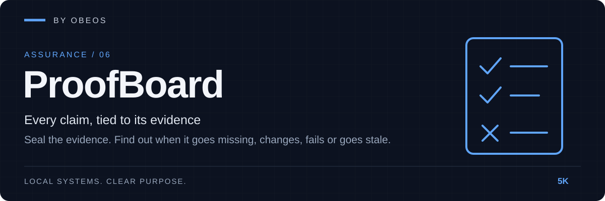

<div align="center">



**Every claim, tied to its evidence. Seal the evidence, then find out when it goes missing, changes, fails or goes stale.**

[](https://github.com/5K-bit/ProofBoard/actions/workflows/ci.yml)


[](LICENSE)

</div>

[Quick start](#quick-start) · [Demonstration](#demonstration) · [Tests](#tests-and-evidence) · [Limitations](#limitations)

---

## Overview

Teams say things like "the restore works", "coverage is above 90%" and "no runtime dependencies". ProofBoard turns each of those into a **claim** in a small file, links it to the **evidence files** that back it (a test log, a coverage report, a drill transcript), and **seals** their SHA-256. From then on `proofboard check` tells you, claim by claim, whether the evidence is still **passing its checks**, or has gone **missing**, **drifted** (changed after sealing), **failed** a content rule, or gone **stale**.

Part of the OBEOS projects, and it works completely on its own. No server, no account, no network access; it reads the files in one folder and writes a report.

> **It detects change, not dishonesty.** A sealed false log reads as CHECKS PASSED. The board shows that evidence is unchanged and meets the rules you wrote; it is not an audit. See [Limitations](#limitations).

## Demonstration

A real run on a made-up project ([`examples/demo`](examples/demo/), "Orchard Sync"). Excerpt; the full transcript is [docs/evidence/acceptance-transcript.txt](docs/evidence/acceptance-transcript.txt), and the board is in [Markdown](docs/evidence/board.md), [HTML](docs/evidence/board.html) and [JSON](docs/evidence/board.json).

```text
$ proofboard seal --now 2026-10-29T17:00:00Z
sealed 5 files: 5 new, 0 changed, 0 refreshed, 0 unchanged

$ proofboard check --now 2026-10-29T17:00:00Z
  passed      tests-pass             The test suite passes with strong coverage
  passed      restore-drill          A backup can be restored
  passed      no-runtime-deps        No runtime dependencies
  passed      threat-model-reviewed  The threat model was reviewed this quarter
4 claims: 4 passed
[exit 0]

# someone edits the restore drill after the fact
$ proofboard check --now 2026-10-29T17:00:00Z
  drifted     restore-drill          A backup can be restored
      ! evidence/restore-drill.txt: changed since it was sealed (sealed dc0beaca0e6d, now 457c92752cca)
4 claims: 1 drifted, 3 passed
[exit 2]

$ proofboard seal --now 2026-10-29T17:00:00Z
These sealed files have changed. Nothing was written.
  changed: evidence/restore-drill.txt
If the change is expected, run again with --accept-changes.
[exit 2]
```

The transcript goes on to show a failed content rule, a deleted file and evidence going stale. Reproduce it: `python examples/acceptance.py --out /tmp/evidence`. This repository checks itself the same way: its own claims are in [`proofboard.toml`](proofboard.toml) and `proofboard check` runs in CI.

## Quick start

**Requirements:** Python 3.11 or newer.

```bash
git clone https://github.com/5K-bit/ProofBoard && cd ProofBoard
pip install .                       # no other dependencies
proofboard init                     # writes a starter proofboard.toml
# edit proofboard.toml, produce your evidence files, then:
proofboard seal                     # record their SHA-256
proofboard check                    # exit 0 only if every claim passes its checks
proofboard board --format html --out board.html
```

Try it without a project of your own: `cp -r examples/demo /tmp/demo && proofboard seal -C /tmp/demo && proofboard check -C /tmp/demo`.

A claim in `proofboard.toml`:

```toml
[[claim]]
id = "restore-drill"
title = "A backup can be restored"
max_age_days = 30                      # optional; default comes from [board]

  [[claim.evidence]]
  path = "evidence/restore-drill.txt"  # relative, inside the project
  contains = ["drill: ok", "checksums matched: 214 of 214"]
  not_contains = "mismatch"
```

| Rule (per evidence file) | Holds when |
|---|---|
| *(none)* | the file exists, is sealed and unchanged |
| `contains` / `not_contains` | the text is / is not in the file (string or list) |
| `matches` | a regular expression matches a line |
| `coverage_min = N` | coverage is at least N%, read from `coverage.xml`, `coverage.json` or a pytest-cov `TOTAL` line |
| `junit_clean = true` | a JUnit XML file has tests and no failures or errors |

| Command | Purpose |
|---|---|
| `init [--force]` | Write a starter claims file |
| `seal [--accept-changes] [--refresh]` | Record each evidence file's SHA-256. Refuses to overwrite a changed hash unless `--accept-changes`; `--refresh` re-dates unchanged files |
| `check [--format text\|json]` | Verify every claim; exit 2 unless all pass |
| `board [--format md\|html\|json] [--out F] [--strict]` | The full board with every file, hash and rule result |

All commands take `-C ROOT`, `--config`, `--lock`; `seal`, `check` and `board` take `--now` for a fixed clock. Exit codes: 0 ok, 1 error (bad file, unreadable path), 2 checks not passed (or a refused seal).

## Architecture

```
proofboard.toml ─► model ─► evaluate ─► render ─► text · Markdown · HTML · JSON
 claims + rules     strict     │   ▲
                    parser     │   └── content rules on each file
proofboard.lock.json ─► ledger ┘
 sealed SHA-256s, own digest
```

Details: [docs/architecture.md](docs/architecture.md) · [threat model](docs/threat-model.md) · decisions in [docs/adr/](docs/adr/).

## Tests and evidence

```bash
pip install -e ".[dev]"
ruff check . && ruff format --check . && mypy
python -m pytest --cov
proofboard check            # this repository's own claims
```

The last recorded run (Linux, Python 3.13) is in [docs/evidence/test-run.txt](docs/evidence/test-run.txt). What each claim rests on:

| Claim | Evidence |
|---|---|
| Claims files are validated strictly; unsafe paths, unknown keys, bad rules and XML entities are rejected; each content rule works on both sides of its threshold | [`tests/unit/test_model_checks.py`](tests/unit/test_model_checks.py) |
| Every status (passed, stale, unsealed, drifted, missing, failed, no evidence) is reached; the lock detects hand edits; sealing refuses silent changes; links out of the folder fail | [`tests/unit/test_ledger_evaluate.py`](tests/unit/test_ledger_evaluate.py) |
| Reports match golden files; hostile text is inert in every format; 300 mutated claims files never crash | [`tests/unit/test_render_fuzz.py`](tests/unit/test_render_fuzz.py) with [golden files](tests/fixtures/) |
| CLI behaviour and exit codes; the demo workflow reproduces the recorded evidence exactly | [`tests/integration/test_cli_acceptance.py`](tests/integration/test_cli_acceptance.py), [evidence](docs/evidence/) |
| ProofBoard's own claims hold | [`proofboard.toml`](proofboard.toml), checked in CI |

## Limitations

ProofBoard does not claim more than it has shown:

- **Unchanged is not true.** A seal shows a file is what it was when sealed, not that it was honest. Write rules that would fail if the claim were false.
- **The lock is tamper-evident, not signed.** Anyone who can rewrite both the lock and the evidence can make a board green. Commit the lock and review its diffs.
- **It does not run your tests.** You produce the evidence; ProofBoard checks it. Nothing from a claims file is ever executed.
- **Rules are simple.** Text, regular expression, a coverage figure, JUnit totals. A rule like `contains = "passed"` is satisfied by the word anywhere in the file.
- **Staleness uses the sealing machine's clock.**
- **Tested on made-up projects.** The demo and the fuzzing are hand-built. Real reports from other tools may expose gaps in the coverage and JUnit readers; send a sanitised example if one fails.
- **Not yet verified on Windows by hand.** CI runs the tests on Windows; nothing has been checked against a real Windows workflow.

## Roadmap

- [x] Claims file, seal, check, board; five rules; demo and self-check
- [ ] Run on GitHub CI (Linux and Windows) and confirm the matrix is green
- [ ] Read more formats: SARIF, CycloneDX and SPDX summaries, Cobertura variants
- [ ] Import evidence from other OBEOS projects (Casefile exports, RestorePoint drills, Dockyard bundles)
- [ ] `obeos.manifest.json` integration so a component's release can be gated on its claims
- [ ] Optional signing of the lock

## Development practice

AI tools assist with implementation, debugging, tests and documentation in this project.
Louis Boddie owns direction and acceptance decisions; the linked tests and [evidence](docs/evidence/) document what is verified.

## Contributing

Issues and pull requests are welcome. See [CONTRIBUTING.md](CONTRIBUTING.md) and [SECURITY.md](SECURITY.md).

## License

[Apache-2.0](LICENSE) © 5K-bit
